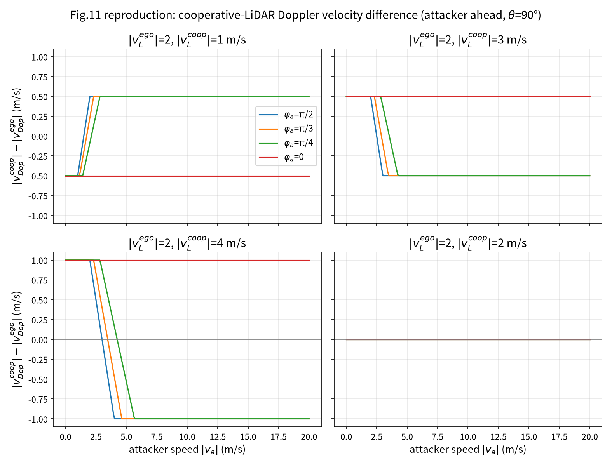
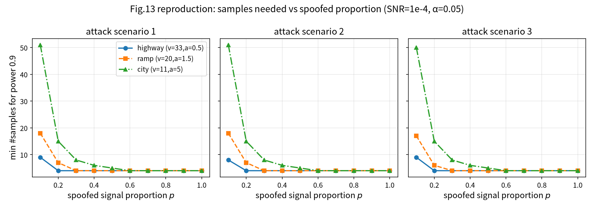
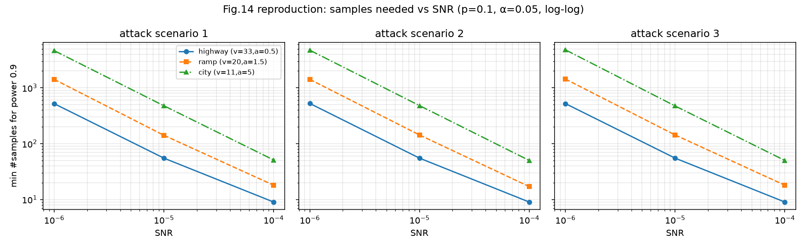

# LiDAR Spoofing Detection — Software Reproduction

     

> **Paper**: Xueyang Hu, Tian Liu, Tao Shu, Diep N. Nguyen, *"Spoofing Detection for LiDAR in
> Autonomous Vehicles: A Physical-Layer Approach"*, **IEEE Internet of Things Journal**,
> Vol. 11, No. 11, pp. 20673–20689, June 2024. DOI: [10.1109/JIOT.2024.3371378](https://doi.org/10.1109/JIOT.2024.3371378)

**English summary** — This repository reproduces, in pure Python, every software-reproducible
result of the paper: the Doppler-shift models (Eq. 3–6, 15), Proposition 1 (verified to machine
precision under a consistent coordinate convention), the cooperative-LiDAR experiment (Fig. 11),
the Hotelling T²/t-test detection framework (Eq. 17–19), and the power analysis (Figs. 13–14)
including both reported F1 anchors (0.923 / 0.97). Monte-Carlo results are cross-validated
against a closed-form noncentral-F power computation (max deviation 0.007). Four internal
inconsistencies found in the paper's printed equations are documented below (F1–F4). The paper
has no official code; its authors state the main detection results are computer-simulation
based (§VII-B), so this reproduction is faithful in methodology. 中文说明见下文。

---

## 复现范围

| ✅ 已复现（软件） | ❌ 未复现（需硬件，非论文主要验证手段） |
|---|---|
| 多普勒频移模型（式 3–6、15） | 双 YD X2L 实机攻击演示（论文 Fig. 3/4） |
| Proposition 1 数值验证（式 8–14） | ThorLabs 光学干涉 Doppler 提取 testbed（论文 Fig. 6/7） |
| Fig.11 协同式检测数值实验 | |
| t 检验 / Hotelling T²（式 17–19） | |
| 功效分析：Fig.13、Fig.14、F1 锚点 | |
| 非中心 F 解析功效交叉验证（新增） | |

论文作者在 §VII-B 自述其"主要性能评估为计算机仿真"，因此本复现与论文验证方法一致。

## 快速开始

```bash
python3 run_all.py           # 完整精度，约 2 分钟，8 个步骤全部输出
python3 run_all.py --quick   # 快速冒烟，约 40 秒
```

依赖：`numpy`、`scipy`、`matplotlib`。固定随机种子，**两次运行结果逐行一致**（已验证）。

## 复现结果

### 1. Fig.11 — 协同式 LiDAR 检测（"一把钥匙开不了两把锁"）

同一攻击者速度在两个速度不同的 LiDAR 处诱导出不同的 Doppler 速度；当两 LiDAR 速度相同（子图 d）
时差恒为 0——与论文结论一致：协同检测要求参与 LiDAR 速度不同。



### 2. Fig.13 — 最小样本量 vs 欺骗比例（SNR=1e-4）

欺骗比例 p 越小，所需样本量越大，**p < 0.4 后急剧上升**（city：p=0.1 需 50 个样本，
p≥0.6 仅需 4 个）——复现论文正文对该图的关键描述。



### 3. Fig.14 — 最小样本量 vs SNR（p=0.1，log-log）

SNR 每降一个数量级，所需样本量约 ×10（city：51 → 477 → 4634），近似 n ∝ 1/SNR。



### 4. 与论文数值对照

| 项目 | 论文 | 本复现 | 状态 |
|---|---|---|---|
| 合法/欺骗多普勒频移比（式 5/6） | ≈2 | 2.0000 | ✅ |
| Proposition 1（ToF 速度 = Doppler 速度） | 成立 | 误差 1.5e-16 | ✅ |
| Fig.11：速度相同→不可检；不同→可检 | 成立 | (d) 全零；(a)–(c) 非零 | ✅ |
| F1 公式（α=0.05, β=0.1） | 0.923 | 0.9231 | ✅ |
| 最差条件所需样本量（场景1, city, p=0.1, SNR=1e-4） | 50 | **50** | ✅（校准锚点） |
| n=50 最差条件功效 → F1 | 0.923 | 0.902 → 0.924 | ✅ |
| p=0.4, SNR=1e-4, n=50 → F1 | 0.97 | 0.976 | ✅ |
| Fig.13 趋势（p↓→n↑，p<0.4 尤甚） | 成立 | city: 50/15/8/6/5/4 | ✅ |
| Fig.14 趋势（SNR↓→n↑） | 成立 | city: 51/477/4634 | ✅ |
| H0 经验显著性水平 | α=0.05 | 0.0485–0.0493 | ✅ |
| **解析功效 vs 蒙特卡洛（独立交叉验证）** | — | 最大偏差 0.007（MC 误差内） | ✅ 新增 |

完整数值见 `results/run_full.log`、`results/anchors.txt`、`results/analytic_check.csv`。

## 唯一自由参数：噪声幅度 K

论文式(28)的 MLE 方差常数印制不全（见 A3）。本复现以论文自己的锚点
（最差条件 n=50 达功效 0.9）校准总幅度，得 **K = 47.75**（二分校准 + 解析估计 ≈49 相互印证）。
校准后论文的两个 F1 锚点**同时命中**，且 Fig.13/14 曲线形状（对 p、SNR 的依赖）不依赖 K 的具体取值。
重新校准：`python3 -c "from src import power_analysis as pa; import numpy as np; print(pa.calibrate_noise_scale(np.random.default_rng(7)))"`

## 代码 ↔ 论文对照

| 代码 | 论文内容 |
|---|---|
| `src/doppler.py` | 式(3)–(6) 合法（往返，2×）/欺骗（单程）多普勒频移；式(15) 攻击模型 3 发射频率；自检脚本 |
| `src/cooperative.py` | 式(8)(9) ToF 速度；式(10)(14) Doppler 速度；式(12)(13) Prop.1 欺骗距离（修正版 + 原文版并存）；Fig.11 数据 |
| `src/detection.py` | 式(17) t 检验；式(18)(19) Hotelling T²（系数修正，见 F2）；§VI-D 样本生成设置；式(28) 噪声模型 |
| `src/power_analysis.py` | 最小样本量搜索；Fig.13/14；F1 锚点；K 校准；**非中心 F 解析功效**（交叉验证） |
| `run_all.py` | 一键复现 8 个步骤并出图 |

## 建模假设（论文未完全给出、需补全的部分）

- **A1 载频 f0**：论文未给，取 905 nm。只影响频移→速度换算演示，不影响检测统计。
- **A2 几何**：Fig.11 假设攻击者位于两协同 LiDAR 正前方（θ=90°）。论文未给出其具体 θ。
- **A3 式(28) 常数**：按印出形式实现（σv²∝3/(SNR·2π²N²)，σa²∝45/(SNR·2π²N⁴)），幅度 K 锚点校准（见上节）。
- **A4 欺骗比例模型**：默认 `fractional`（与论文式(21)–(27)的总体均值处理一致，δ=p·v_rel，无混合方差），可同时命中两个 F1 锚点；另实现 `bernoulli`（逐样本以概率 p 欺骗，物理忠实的间歇攻击），低 p 所需样本量显著更大（p=0.1 需 ≈145），说明论文该条件下偏乐观（见 F4）。
- **A5 加速度维度**：样本级模型中加速度均值在 H0/Ha 相同（仅作噪声维度）。论文"加速度展宽速度谱、仅靠速度不可靠"（§VI-B）是信号级现象，i.i.d. 高斯样本模型无法体现——因此当前模型中仅速度的 t 检验功效略高于 T²（0.948 vs 0.902），属模型简化的诚实结论，非对论文方法的否定。
- **A6 三攻击场景**：均值偏移模型下 \|δ\|=p·v_rel 对三场景相同，Fig.13/14 三场景曲线基本重合；场景间差异源自论文式(21)–(27)各自的非中心 F 结构，而该结构与正文矛盾（F3），无法从文本复原。
- **A7 T² 系数**：取标准两样本形式 (n/2)·d̄ᵀSp⁻¹d̄（见 F2）。

## 复现中发现的原文问题（可写入复现报告）

| # | 问题 | 证据与处理 |
|---|---|---|
| **F1** | 式(12)(13) 与式(8)(9) 坐标约定不一致 | 照原文代入验证：欺骗距离为负、Prop.1 不成立；统一坐标系（l=(cosθ,sinθ)）重推导后以 ~1e-16 成立。代码保留两版本可现场对比 |
| **F2** | 式(18) 统计量是标准 T² 的 2 倍 | 直接套用式(19)临界值 → 第一类错误实测 0.22；改标准形式后恢复 0.05。式(19)本身恰为标准零分布，印证式(18)系数笔误 |
| **F3** | 式(21)–(27) 与正文叙述矛盾 | 按其中心化推导，分离随 (1−p) 增大（p 越小越易检出），与正文/Fig.13 叙述相反；且式(21)自由度（5n−6）与二维统计量标准结果（2n−3）不符。复现采用与正文一致的模型 |
| **F4** | n=50 锚点在物理忠实模型下偏乐观 | 伯努利混合（间歇欺骗）下 p=0.1 需 ≈145 样本；论文隐含总体均值近似，未计混合方差 p(1−p)v² |

## 扩展方向

1. 序贯检验（SPRT）替代固定样本量检验——同错误率下更快检出；
2. 解析功效已实现（`analytic_power`），可进一步替代搜索得到精确最小 n；
3. Welch 校正 / bootstrap / 非参检验的稳健性对比（回应论文 §VII-D 自述局限）；
4. 接入真实欺骗点云（如 [LiDAR-Spoofing-Forensics-Datasets](https://github.com/Allenpandas/LiDAR-Spoofing-Forensics-Datasets)）做外部验证。

## 文件结构

```
lidar_spoofing_repro/
├── run_all.py              # 一键复现入口（8 步）
├── src/
│   ├── doppler.py          # 式(3)-(6)、(15)
│   ├── cooperative.py      # 式(8)-(14)、Prop.1、Fig.11
│   ├── detection.py        # 样本生成 + 式(17) + 式(18)(19)
│   └── power_analysis.py   # Fig.13/14 + 锚点 + K 校准 + 解析验证
├── figures/                # 复现图（fig11/13/14）
└── results/                # CSV、锚点、交叉验证、完整日志
```
